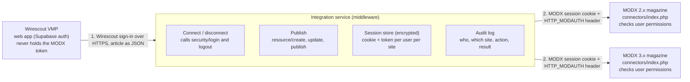

# MODX Integration Research

2 November 2026 · Kenneth Zuniga · verified against the MODX source. Live version: https://claude.ai/artifact/CUGVLJss4zoU5gGQSEq4vY

## Summary

Wirescout VMP can connect a user's existing MODX account and publish on their behalf without changing any MODX code, by using the connector endpoint the MODX manager itself uses. The recommended design is a small middleware service that logs the user in through that connector, keeps the resulting session and token server-side, and calls the standard resource processors as that user. Every write then runs under the user's own MODX permissions.

This was verified in the MODX core source (Revolution 2.8.3 in the corporate-disclosures repo, and the 3.x branch on GitHub), not assumed. The approach in the earlier auth.js experiment is the right mechanism, but its token handling needs to move into the middleware rather than be returned to the client.

| Approach | Verdict | Why |
| --- | --- | --- |
| Connector login plus HTTP\_MODAUTH header, driven from a middleware | Viable | Built into every MODX 2.x and 3.x install, permission-checked, no files added |
| Built-in REST service (modRestService) | Viable with limitations | Needs a rest/index.php and controllers added to each site, and its own auth code |
| mxHeadless extra (API keys, OAuth) | Viable with limitations | MODX 3.2.3+ only; keys are not clearly bound to a user; needs a package installed per site |
| OAuth2Server extra | Not recommended | Old, token in URL only, grants no permissions by itself |
| Calling the connector straight from the browser | Not recommended | Cookies and token would live in the user's browser, cross-origin blocks, no audit point |
| Reading the MODX database directly | Not viable for this goal | Bypasses permissions and workflow; needs database credentials per site |

## What MODX offers external applications

MODX has no public REST API out of the box, but it has one general-purpose HTTP interface that every install ships with: the connector. Everything below was read from the MODX source.

**Connectors and processors (built in, 2.x and 3.x).** The MODX manager is itself a JavaScript client. Every action it takes is an HTTP POST to connectors/index.php with an action name such as security/login or resource/create, and MODX runs the matching processor class. Three rules gate it:

1. The login action is the only one allowed anonymously. The file sets MODX\_REQP to false for security/login and then skips the context policy check.
2. Every other action needs a logged-in session for the chosen context (the ctx parameter, default mgr) and a token that matches the session. The token can be sent as the HTTP\_MODAUTH request header or as a request parameter. A missing or wrong token returns 401.
3. Each processor checks its own permission. resource/create requires new\_document, and additionally publish\_document to publish and new\_document\_in\_root for the tree root. Permissions come from the user's groups and access policies, exactly as in the manager.

The login processor returns that token in its JSON response and sets the session cookie. It also applies the site's brute-force settings (failed\_login\_attempts, blocked\_minutes) and manager-access checks (a mgr login is refused and logged out if the user lacks the frames permission). This is the mechanism auth.js used in the earlier experiment.

**Built-in REST service (modRestService, 2.3+).** MODX ships classes to build a REST API, but not an endpoint. A site owner must add a rest/index.php plus controller classes under the web root and write the authentication themselves: the base controller's verifyAuthentication simply returns true. The MODX 2.x docs page for this exists but was not fetchable during this research; the classes were confirmed in the local core.

**Third-party extras.**

| Extra | Scope | Fit for this project |
| --- | --- | --- |
| [mxHeadless](https://docs.modx.pro/en/components/mxheadless/) | Full JSON API under /api/v1, API keys and OAuth client-credentials tokens, scopes plus MODX ACL, OpenAPI docs. GPL, free. | Strong for new MODX 3 sites, but requires MODX 3.2.3+ and PHP 8.1+, and the docs do not state that an API key acts as a specific MODX user. corporatedisclosures.org is MODX 2.8.3. |
| [OAuth2Server](https://github.com/modxcms/oauth2-server) | Issues and verifies OAuth2 tokens for a site | No releases, token only accepted in the URL, grants no permissions. Not suitable. |
| [modJWT](https://community.modx.com/t/modjwt-working-with-json-web-token-jwt-on-modx/330) | JWT helper | Still needs custom REST code around it. |
| Login extra (installed on the site) | Front-end login for web-context users (subscribers) | Not relevant to publishing: it authenticates readers, not editors. |

**Conclusion for this section.** The connector is the only interface that is present on every MODX install, needs nothing added, and enforces the user's real permissions. The REST service and mxHeadless are cleaner APIs but each requires something installed or written on every magazine.

## Account integration

A user connects their MODX account by entering their MODX username and password once in Wirescout; the middleware exchanges them for a MODX session and token and never stores the password. There is no OAuth or "sign in with MODX" flow in core, so a credential exchange is the only supported option on an unmodified install.

**How the connection works**

1. Wirescout sends the username and password to the middleware over HTTPS, together with which magazine (site) the user is connecting.
2. The middleware POSTs them to that site's connectors/index.php with action security/login, ctx mgr, and rememberme true.
3. MODX answers with a session cookie and a token. The middleware stores both, encrypted, against the Wirescout user and site. The password is discarded.
4. Later calls send the cookie and the token in the HTTP\_MODAUTH header (request header name `modAuth`), plus `X-Requested-With: XMLHttpRequest` so refusals come back as HTTP 401 rather than HTTP 200 with `code: 401` in the body. MODX treats them exactly like a manager tab.
5. To disconnect, the middleware calls action security/logout and deletes its stored cookie and token.

**Which MODX accounts qualify.** The account must be a manager user: in a user group whose policy grants access to the mgr context and the frames permission, plus new\_document for creating articles and publish\_document for publishing. Subscribers created through the front-end Login extra live in the web context and cannot publish. The login processor refuses a manager login for a user without frames, so the connection step itself tells Wirescout whether the account is an editor.

**Permission model to respect.** All of it is enforced by MODX, not by Wirescout: context access, resource-group access, element and template permissions, and the per-action permissions above. The middleware should treat a 401 or a permission\_denied response as the final answer and show it to the user, never retry with another account.

**Session lifetime.** The token lives in the PHP session. With rememberme the cookie lasts for the site's session\_cookie\_lifetime setting (MODX default 7 days). MODX also rotates the session on login and clears the token on logout, on password change, and when the user is blocked. The middleware must therefore handle "session gone" as a normal event: mark the connection as needing re-authentication and ask the user to sign in again.

**Suggested user experience**

- Settings page "Connected magazines": one row per site with the MODX username, status (Connected, Needs sign-in, Disconnected), connected date and a Disconnect button.
- Connect dialog: pick the magazine, enter MODX credentials, see the result. On success show the MODX display name read back from the session so the user can confirm it is the right account.
- Re-authentication prompt inline at the moment of publishing, not as a background failure.
- One Wirescout user may connect several magazines, and several Wirescout users may connect the same magazine with their own accounts. Connections are never shared between users.

## Content management

An article in MODX is a resource, and the connector exposes the full resource lifecycle through the same processors the manager uses. No MODX change is required to create a draft, update it, or publish it, as long as the connected user may do so.

| Action | Connector action | Permission checked by MODX |
| --- | --- | --- |
| Create a draft article | resource/create with published 0 | new\_document (and new\_document\_in\_root if parent is the root) |
| Create and publish in one step | resource/create with published 1 | new\_document plus publish\_document |
| Update an article | resource/update | save\_document, edit\_document, and resource-group access |
| Publish or unpublish | resource/publish, resource/unpublish | publish\_document, unpublish\_document |
| Read articles the user may see | resource/getlist, resource/get | view\_document and resource-group access |
| Upload an image | browser/file/upload | file\_upload and a media source the user can access |

**What a create call needs.** At minimum pagetitle, parent (the section the article lives in), template, context\_key, and content. Real magazines also use template variables (standfirst, author, hero image, category) and these are passed as tv fields in the same call. Which fields exist, and which parent and template mean "article", are site-specific and must be configured per magazine in the middleware.

**Workflows.** MODX core has no editorial workflow beyond published or unpublished plus a scheduled publish date (pub\_date). The practical options are:

- Wirescout creates an unpublished draft and an editor publishes in the MODX manager. Lowest risk, works with every permission setup.
- Wirescout publishes directly for users who already hold publish\_document. Same permission as pressing Publish in the manager.
- Wirescout sets pub\_date for scheduled publishing, which MODX handles itself.

**Limits that vary by install**

- Permissions: a user who cannot create in a given section in the manager cannot do it through Wirescout either. This is a feature, not a limit to work around.
- Required template variables, custom plugins on OnDocFormSave, and cache clearing behave exactly as they do for a manager save, because it is the same code path.
- MODX 2.x and 3.x name processors differently inside the core, but the action strings sent over HTTP (resource/create and so on) are the same, so one middleware can serve both.
- Rich content formatting (the site's TinyMCE conventions, chunks, image paths) is a content-mapping job in the middleware, not an API question.
- Rate: the connector is not built for bulk. A few publishes per user per day is well within normal manager usage.

## Architecture comparison

A dedicated middleware built as a reusable per-site connector is the only option that is secure, needs no MODX change, and scales to many magazines. The three candidates:

|  | Direct from the Wirescout browser app | Dedicated middleware service | Reusable connector inside the middleware (one adapter, many sites) |
| --- | --- | --- | --- |
| MODX changes needed | None, but each site must add CORS headers to connectors, which is a change | None | None |
| Where the session and token live | User's browser | Middleware database, encrypted | Middleware database, encrypted, keyed by user and site |
| Credential exposure | Password and token pass through browser code and dev tools | Password seen once by the middleware, then discarded | Same |
| Permissions enforced by MODX | Yes | Yes | Yes |
| Audit trail | None beyond the MODX manager log | Middleware logs every call with user, site, action, result | Same, plus per-site health |
| Supports MODX 2.x and 3.x | Yes | Yes | Yes, with one adapter and per-site config (version, parent id, template id, fields) |
| Adding a new magazine | Per-site CORS and front-end config | Code change if site specifics are hard-coded | Add a config record, no deploy |
| Deployment complexity | Lowest | One small service plus a database and a secret store | Same as middleware |
| Scalability | Limited by browser session rules | Stateless workers, sessions in the store | Same |
| Maintainability | Poor: MODX quirks leak into the product UI | Good: MODX knowledge in one place | Best: site differences are data, not code |
| Fit for Wirescout | Not recommended | Viable | Recommended |

**Why not direct.** Browsers will not send the MODX session cookie cross-origin unless each magazine sets CORS and SameSite rules on its connector, which is exactly the kind of change the team wants to avoid. It also puts the token, which is equivalent to a logged-in manager session, into client-side code.

**Why the reusable connector layer.** The MODX calls are identical across magazines; what differs is the host, the version, the parent section id, the template id, and the template-variable names. Treating those as a per-site configuration record keeps one code path for all Field Gibson Media titles and any future MODX site, and the same layer can later host a second adapter for a non-MODX platform without touching Wirescout.

## Recommended architecture

Build a small integration service between Wirescout and the magazines. It owns the MODX sessions, Wirescout only ever talks to it, and each magazine is a configuration record rather than code.

Wirescout never receives the MODX cookie or token; the service exchanges the user's credentials once, keeps the pair encrypted, and signs every MODX call with it.

**Minimum requirements to implement**

1. A service with its own authentication for Wirescout calls (Supabase JWT verification), reachable only over HTTPS. Node with Fastify, as in auth.js, or PHP; both are fine.
2. A database table of connections: Wirescout user, site, MODX username, encrypted cookie, encrypted token, status, created and last-used timestamps. Encryption key held in the platform's secret store, not in the table.
3. A site registry: host, MODX major version, parent resource id for articles, template id, template-variable names, media source id. One row per magazine.
4. Four endpoints: connect, disconnect, status, publish. Publish accepts a Wirescout story id and returns the MODX resource id and URL.
5. Error mapping: MODX 401 becomes "needs sign-in"; permission\_denied becomes a plain message to the user; connection errors are retried once, then surfaced.
6. An audit log row per MODX call, kept for at least 90 days.
7. A staging MODX install (the corporate-disclosures Docker setup already exists) with a test editor account, used to verify login, create, publish and logout before any production site is registered.

Nothing is installed or changed on any magazine. The only per-site work is adding its registry row and confirming the editor's permissions.

## Security and account management

The approach is as secure as the MODX manager itself, provided the middleware treats the stored cookie and token as a manager login, because that is what they are. The main risks and their mitigations:

| Risk | Why it matters | Mitigation |
| --- | --- | --- |
| Stored session equals a logged-in manager | Anyone who reads the connections table can act as every connected editor | Encrypt cookie and token at rest with a key from the secret store; restrict table access to the service; rotate the key; log every read |
| Password handling | The middleware sees the user's MODX password once | Accept it only over HTTPS, pass it straight to MODX, never log or persist it; the earlier auth.js already does this |
| Token returned to the client | auth.js returned the MODX cookie to the caller, which moves the risk into the client | Keep the pair in the middleware only; Wirescout gets an opaque connection id |
| Session expiry and revocation | MODX ends sessions on logout, password change, blocking, and after session\_cookie\_lifetime | Treat 401 as "reconnect needed"; call security/logout on disconnect; offer "disconnect everywhere" by deleting all rows for a user |
| Brute force through the connector | The login endpoint is public on every MODX site | MODX blocks after failed\_login\_attempts; add the middleware's own rate limit per user and per site; never retry a failed login automatically |
| Middleware as a new attack surface | A compromise exposes all connections | Small codebase, no public endpoints beyond the four, Wirescout JWT required on all of them, dependency scanning, separate secrets per environment |
| Permission drift | An editor loses rights in MODX after connecting | Nothing to do: MODX re-checks permissions on every call, so the publish simply fails and the user is told |
| Multiple users, multiple sites | A bug could post one user's story under another's account | Key every row and every call by (Wirescout user, site); never share connections; include both in the audit log |
| Server-side request forgery | The site host must not be user-supplied | Hosts come only from the site registry, never from request input |

**HTTP headers.** Sending the token in the HTTP\_MODAUTH header is the officially intended path: the MODX security docs describe it as how the manager and custom manager pages sign requests, and the core accepts the header or a request parameter. Headers are not visible in URLs or server access logs, so the header form is the right one. Over HTTPS they carry no extra risk beyond the session itself.

**Findings in the reference material**

- auth.js (previous experiment) is sound in its login call and timeout handling, but it returns the MODX cookie to the caller and logs in to the web context rather than mgr. For publishing it must use ctx mgr and keep the cookie and token server-side.
- The corporate-disclosures codebase has a plugin, autoLoginCookie.php, that keeps a front-end reader signed in using a cookie containing the username and the stored password hash. This is unrelated to the Wirescout integration but is a pre-existing weakness worth raising with the site's maintainers.

**Account management rules**

- One MODX account per Wirescout user per site, chosen and entered by that user.
- The user can see and remove every connection; an admin can remove a user's connections but never see the stored pair.
- Deleting a Wirescout user deletes their connections and calls security/logout on each.
- Published articles are attributed in MODX to the connected account, so the audit trail exists on both sides.

## Dependencies on each MODX installation

The mechanism is the same on every MODX site, but five facts differ per site and must be captured in the site registry before a magazine can be connected.

| Dependency | Where it comes from | corporatedisclosures.org (from the repo) |
| --- | --- | --- |
| MODX version | core/docs/version.inc.php | Revolution 2.8.3-pl |
| Connector reachable from the middleware | Web server config; some hosts restrict /connectors or /manager by IP | nginx config in the repo applies no restriction, so it is reachable; confirm on the live host |
| HTTPS on the site | Hosting | Production serves HTTPS; the repo's nginx listens on port 80 behind a proxy |
| Article template and parent section | Site structure | A template named article.html exists; its id and the parent section id must be read from the database |
| Template variables required for an article | Site structure and TinyMCE conventions | To be listed from the staging database |
| Session settings | System settings: session\_cookie\_lifetime, failed\_login\_attempts, blocked\_minutes | MODX defaults unless changed in the manager |
| Editor accounts for Wirescout users | User groups and policies in the manager | Each journalist needs a manager account with new\_document and publish\_document in the article section |

**Open questions to verify on the staging install**

- [x] Login with ctx mgr returns a token and cookie for a journalist account, and the frames check passes. (Staging, 2026-11-02, all 4 magazines)
- [x] resource/create with that session creates an unpublished draft in the article section with the right template. (Staging, 2026-11-02; template variables not yet exercised)
- [x] resource/publish works for an account with publish\_document (Staging, 2026-11-02, all 4 magazines). Refusal for an account without it: not yet tested.
- [x] security/logout invalidates the token, and the next call returns 401. (Staging, 2026-11-02, all 4 magazines)
- [ ] The same flow works against a MODX 3.x install, to confirm the one-adapter claim.
- [ ] Image upload through browser/file/upload lands in the magazine's media source.

The staging environment should be the Docker setup from the corporate-disclosures repo with a copy of the database and a dedicated test editor account, with permission from the site owner before any test.

## Sources

Verified in source code (read, not executed):

- MODX Revolution 2.8.3-pl core in the corporate-disclosures repository: connectors/index.php (anonymous security/login, context load policy), core/model/modx/modconnectorresponse.class.php (HTTP\_MODAUTH header or parameter must match the session token), core/model/modx/processors/security/login.class.php (token in response, blocked-login checks, frames check for mgr), core/model/modx/processors/resource/create.class.php (new\_document, publish\_document, new\_document\_in\_root), core/model/modx/rest/ (modRestService and modRestController with verifyAuthentication returning true), src/plugins/autoLoginCookie.php, templates/corporatedisclosures.org.conf.
- [MODX 3.x connectors/index.php on GitHub](https://raw.githubusercontent.com/modxcms/revolution/3.x/connectors/index.php) and [modConnectorResponse.php](https://raw.githubusercontent.com/modxcms/revolution/3.x/core/src/Revolution/modConnectorResponse.php): same anonymous login and HTTP\_MODAUTH rules in MODX 3.
- \~/Downloads/auth.js: the earlier Fastify middleware experiment.

Documentation and community pages opened:

- [MODX security docs (3.x)](https://docs.modx.com/3.x/en/extending-modx/security): request tokens, HTTP\_MODAUTH, session-bound tokens. Page summary via search; the site refused direct fetches during this research.
- [mxHeadless authentication](https://docs.modx.pro/en/components/mxheadless/authentication), [authorization](https://docs.modx.pro/en/components/mxheadless/authorization), [API keys](https://docs.modx.pro/en/components/mxheadless/api-keys), [installation](https://docs.modx.pro/en/components/mxheadless/installation).
- [OAuth2Server extra](https://github.com/modxcms/oauth2-server).
- [modJWT thread](https://community.modx.com/t/modjwt-working-with-json-web-token-jwt-on-modx/330), [Secure REST service inside MODX](https://community.modx.com/t/secure-rest-service-inside-modx/2913), [MODX 3 REST API key thread](https://community.modx.com/t/modx3-rest-api-how-to-use-api-key-security-with-header-authorization/5876).

Not done, by design: no requests to corporatedisclosures.org or any live site, no logins, no content created, no files changed.
