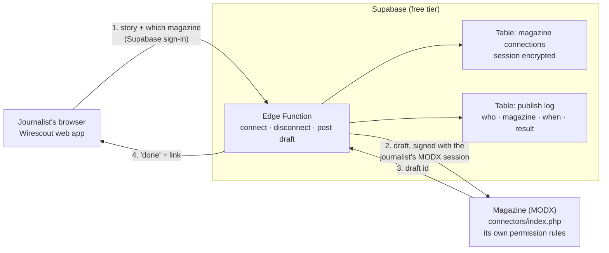

# Post to MODX, in plain words

Written 2026-11-02 for future readers with no MODX background. The full plan is `docs/post-to-modx-plan.md`; the research is `docs/modx-integration-research.md`.

## How it works, in 4 stages

1. **Wirescout (the web app).** A journalist clicks "Post draft to Environmental Finance". The app sends the story to our function. The app never talks to the magazine.
2. **The function (our middle layer).** A small piece of server code that runs inside Supabase. It looks up the journalist's saved MODX session, and sends the draft to the magazine.
3. **The magazine (MODX).** It receives the draft through the same door its own editor screen uses. It checks "is this person allowed to create articles here?" using its own rules. If yes, the draft appears, unpublished, for an editor to review.
4. **Back to Wirescout.** The function returns "done, here's the link". The app shows it.

Connecting an account works the same way, once: the journalist types their MODX username and password in Wirescout, the function hands them to the magazine, the magazine replies "ok, here's a session". The function keeps the session and throws the password away.

What travels where:

| Step | What is sent | Secret? |
| --- | --- | --- |
| 1 | The story and the magazine's name, with the journalist's Wirescout sign-in | Wirescout sign-in only, as for every other app call |
| 2 | The draft, plus the journalist's MODX session (cookie and token) | Yes: it leaves the function only to reach the magazine, over HTTPS |
| 3 | The new draft's id | No |
| 4 | "Done" and a link to the draft | No |

## Do we need a middle layer?

Yes, but not a new server. The middle layer is a Supabase Edge Function. Supabase already runs our database and login, and Edge Functions are free on our plan. No machine to rent or patch.

## Fastify or something better?

Something simpler. Fastify (what the earlier `auth.js` experiment used) is a web server framework. It needs a server to run on, which costs money and maintenance, and breaks the $0 goal. An Edge Function is about 200 lines of TypeScript with no server to look after. The logic from `auth.js` carries over almost line for line.

## Where does the sensitive data live?

- **The MODX password:** nowhere. It is used once to log in, then discarded. Not logged, not saved.
- **The MODX session (cookie and token):** in one Supabase table, encrypted. The encryption key is a Supabase secret only the function can read. The web app and the journalist's browser never see the session. A database admin would see scrambled text.
- **Who posted what:** a log table, so every draft can be traced to a person, a magazine and a time.

## Is it safe?

Yes, as safe as the magazine's own editor screen, because it is the same door.

- The magazine decides what each person may do. If a journalist loses their rights in MODX, Wirescout loses them too, instantly.
- Nothing is installed or changed on the magazines, so nothing new can be attacked there.
- The one real risk is the saved sessions. A saved session equals a logged-in editor. That is why they are encrypted, kept away from the app, and cleared on disconnect or when the journalist deletes their account. The same risk exists today in every editor's browser.
- Tested on local copies of all four magazines (`docs/modx-staging-test.md`): it works, and every "should be refused" case was refused.

## For a manager, in one breath

Wirescout never touches the magazines directly. A small, free function inside Supabase logs in as the journalist, through the same door the editors use, and leaves an unpublished draft. The magazine keeps all its own permission rules. Passwords are never stored; sessions are stored encrypted where only that function can read them. No changes to any magazine.
